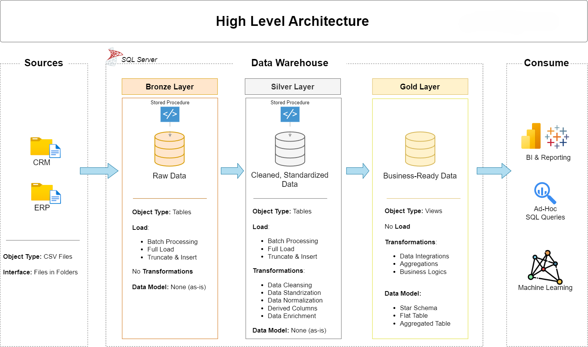

# Data Warehouse and Analytics Project

The materials of the data warehouse project: the source files, every script from the videos, and the docs.

You take raw files from two systems, a CRM and an ERP, and build one data warehouse in SQL Server. At the end, the data is clean and ready for analysis.

**New here? Open the setup guide in the `00_setup` folder.** It walks you through installing SQL Server and creating the database, on Windows and Mac, with the fixes for the common errors.

```
sql-data-warehouse-project/
├── 01_Datasets/            the six source files the project loads
│   ├── source_crm/         three files from the CRM system
│   └── source_erp/         three files from the ERP system
├── 02_Docs/                the requirements, the diagrams and the notes
├── 03_Scripts/             the project scripts, in the order of the videos
│   ├── init_database.sql   creates the database: run it first
│   ├── bronze/             loads the raw files
│   ├── silver/             cleans and prepares the data
│   └── gold/               builds the tables for analysis
└── 04_Tests/               checks the quality of the silver and gold data
```

The project reads the six files from `C:\sql\dwh_project\01_datasets\`. Put the folder there, or change the six paths in `03_scripts/bronze/proc_load_bronze.sql`. The videos show the folders without numbers: `datasets` there is `01_datasets` here, `scripts` is `03_scripts`.

---
## 🏗️ Data Architecture

The data architecture for this project follows Medallion Architecture **Bronze**, **Silver**, and **Gold** layers:


1. **Bronze Layer**: Stores raw data as-is from the source systems. Data is ingested from CSV Files into SQL Server Database.
2. **Silver Layer**: This layer includes data cleansing, standardization, and normalization processes to prepare data for analysis.
3. **Gold Layer**: Houses business-ready data modeled into a star schema required for reporting and analytics.

---
## 📖 Project Overview

In this project, you:

1. **Design the architecture:** a modern data warehouse with three layers, bronze, silver and gold.
2. **Build the ETL pipelines:** load the source files and move the data through the layers.
3. **Model the data:** facts and dimensions, ready for reports.
4. **Analyze it:** answer business questions with SQL.

---
# SQL Data Analytics Project
```
sql-data-analytics-project/
├── 01_Datasets/                     the data, as a backup and as CSV files
│   ├── DataWarehouseAnalytics.bak   the database, ready to restore
│   └── csv-files/                   the same data, to build the database yourself
├── 02_Docs/                         the project roadmap and notes
└── 05_EDA/                      the queries, in the order of the videos
    └── 00_init_database.sql         builds the database from the CSV files
```
- run `03_scripts/00_init_database.sql`. It builds the database from the CSV files in `C:\sql\sql-data-analytics-project\01_datasets\csv-files\`.

## 🗺️ What you build


The project has two parts, and the scripts follow them:

- **Exploratory data analysis**, scripts `01` to `06`: you get to know the data, from the tables and dates to the big numbers and the top performers.
- **Advanced analytics**, scripts `07` to `13`: you go deeper with trends, running totals, performance, part-to-whole and segments. Two reports close the project, one for customers and one for products.

---


## 🛠️ Important Links & Tools

- **[Git](https://github.com/):** a GitHub account, to save and share your project.
- **[draw.io](https://www.drawio.com/):** to draw the architecture and the data model.
- **[Notion template](https://www.notion.com):** the project plan, ready to copy.
- **[Notion project steps](https://app.notion.com/p/SQL-Data-Warehouse-Project-a8ed520c3346828da1ad017e149fa1c0?source=copy_link):** every phase and task of the project.

---

## 🚀 Project Requirements

### Building the Data Warehouse (Data Engineering)

#### Objective
Develop a modern data warehouse using SQL Server to consolidate sales data, enabling analytical reporting and informed decision-making.

#### Specifications
- **Data Sources**: Import data from two source systems (ERP and CRM) provided as CSV files.
- **Data Quality**: Cleanse and resolve data quality issues prior to analysis.
- **Integration**: Combine both sources into a single, user-friendly data model designed for analytical queries.
- **Scope**: Focus on the latest dataset only; historization of data is not required.
- **Documentation**: Provide clear documentation of the data model to support both business stakeholders and analytics teams.

---

### Tableau Customer Analysis Dashboard
An interactive customer analytics dashboard developed using Tableau Desktop and connected to the Gold layer of the SQL Server Data Warehouse.

#### Key Performance Indicators (KPIs)
- **Total Customers**
- **Total Sales**
- **Average Monthly Spend**
- **Average Orders**

#### Visualizations
- **Customer Distribution by Segment**
- **Customer Age Analysis**
- **Top 5 Customers by Sales**
- **Customer Recency Analysis**
- **Customer Order Frequency**

#### Tools & Technologies
- **Microsoft SQL Server**
- **Tableau Desktop**
- **SQL Server Gold Layer**
- **Data Visualization**

These insights empower stakeholders with key business metrics, enabling strategic decision-making.  

### Dashboard Preview


---

## 🛡️ License

[MIT](LICENSE). Use it, change it, share it, with attribution.

